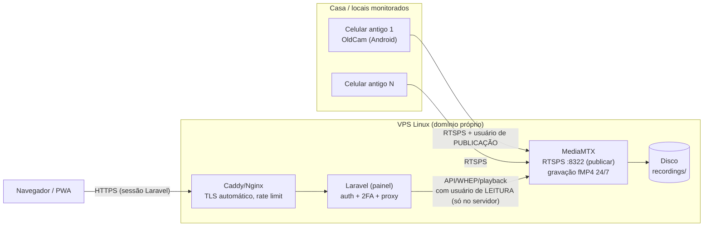
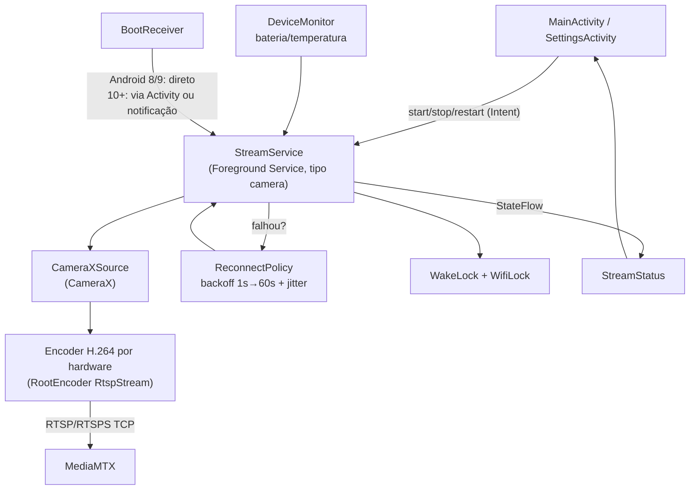

# Arquitetura

## Fluxo de credenciais

| Credencial | Onde vive | Quem usa |
|---|---|---|
| Publicação (por câmera ou compartilhada) | `.env` do servidor + cifrada no Keystore do celular | só os celulares |
| Leitura | `.env` do servidor | só o Laravel (backend) |
| Login do painel (+2FA) | banco do Laravel (hash) | pessoas |

O navegador fala **apenas** com o Laravel. Ao vivo (WebRTC/WHEP) e gravações passam pelo Laravel
(proxy ou tokens curtos assinados), nunca com a senha do MediaMTX no front-end.

## Fase 1 — o app câmera por dentro

